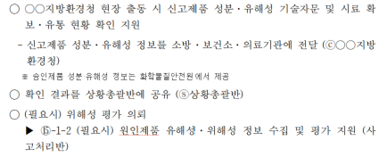
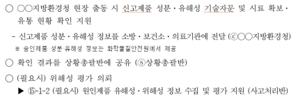
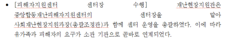
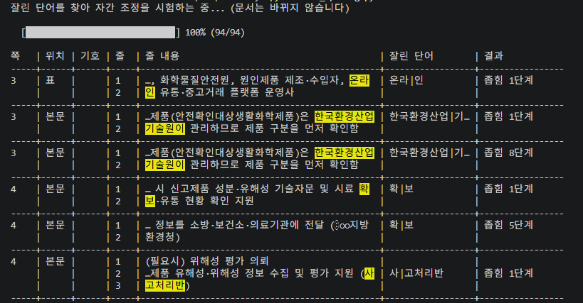
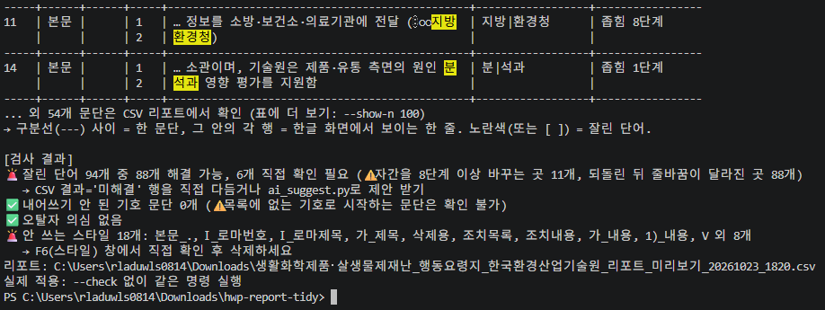
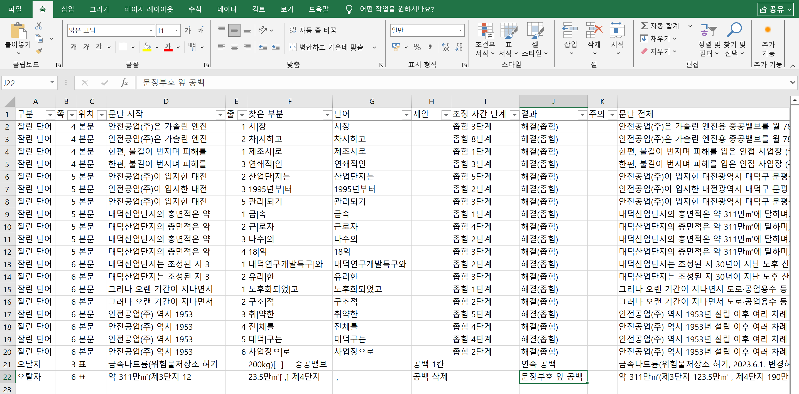

# hwp-report-tidy

> 한글(HWP/HWPX) 보고서의 **줄 끝에서 잘린 단어를 자간 조정으로 붙이고**,
> 마무리 전에 확인할 것들을 알려주는 도구

| 정리 전 | 정리 후 |
|---|---|
|  |  |

<br>

## 왜 만들었나

보고서는 줄 나눔 기준을 **'글자'** 로 두고 작업합니다.
'어절'로 바꾸면 단어는 안 잘리지만, 띄어쓰기 간격이 들쭉날쭉해지기 때문입니다.

<p align="center">
  
</p>

그래서 마무리 때마다 `평가제|도`, `manage|ment`처럼 잘린 단어를 하나씩 찾아
**Alt+Shift+N / W** 로 자간을 맞춰 왔습니다. 이 반복 작업을 자동화했습니다.

<br>

## 빠른 시작

> Windows + 한글(한컴오피스) 필요

```powershell
pip install -r requirements.txt

python fix_spacing.py 보고서.hwpx --check   # 1️⃣ 미리 보기 (문서 안 바뀜)
python fix_spacing.py 보고서.hwpx           # 2️⃣ 실제 적용 → 보고서_정리_날짜시각.hwpx
```

<br>

## 기능

| 기능 | 하는 일 | 문서 수정 |
|---|---|:---:|
| ✂️ **잘린 단어** | ① 잘린 줄을 **좁혀서** 뒷부분을 윗줄로 올리고<br>② 안 되면 **넓혀서** 앞부분을 아랫줄로 내림 | ✅ |
| 🔍 **오탈자 검사** | 연속 공백 · 반복 단어 · 문장부호 앞 공백 · 중복 문장부호 · 괄호 짝 · 자주 틀리는 말 | 찾기만 |
| 🎨 **스타일 점검** | 안 쓰는 스타일 목록 | 알려주기만 |
| ↹ **내어쓰기** (선택) | `□ ○ - 1. 가. ①` 기호 문단을 기호 뒤 글자에 맞춤 | ✅ |

- 본문, 표 안, **표 안의 표**까지 검사합니다.
- 한글 · 영문 · 숫자 모두 처리합니다.

<br>

## 결과 화면

### `--check` 표


- 구분선 사이 = **한 문단**, 각 행 = 한글 화면의 **한 줄**
- 잘린 단어는 <mark>노란색</mark>으로 강조
- 결과: `좁힘 N단계` · `넓힘 N단계` · `⚠ 직접 확인 필요`

### 검사 결과


### CSV 리포트


결과는 엑셀에서 바로 열리는 CSV로 남아, 직접 확인할 곳만 필터로 골라 볼 수 있습니다.
확인할 항목이 없으면 CSV를 만들지 않습니다.

<br>

## 옵션

| 옵션 | 설명 |
|---|---|
| `--check` | 미리 보기. 실제로 해보고 되돌려서 결과만 보여줌 |
| `--only 자간` · `오탈자` · `내어쓰기` | 그 기능만 실행 (여러 개 가능, 기본: 자간 + 오탈자) |
| `--body-only` | 표 안 문단 제외 |
| `--max-steps 15` | 방향별 자간 조절 최대 횟수 (기본 10) |
| `--show-n 100` | `--check` 표에 보여줄 개수 (기본 30, 나머지는 CSV) |
| `--no-mark` | 해결 못 한 단어에 형광펜 안 칠함 |
| `--show` | 한글 창을 띄워 진행 과정 보기 |

<br>

## 직접 확인할 것

| 무엇 | 어디서 보나 | 할 일 |
|---|---|---|
| 자간으로 안 붙은 단어 | 문서의 **노란 형광펜** · CSV 결과 = `미해결` | 문장을 직접 다듬기 (또는 AI 제안) |
| 8단계 이상 조절한 곳 | CSV `조정 자간 단계` | 빽빽하거나 성겨 보이는지 확인 |
| 줄 배치가 바뀌었을 수 있는 곳 | CSV `주의` | 원본과 비교 |
| 오탈자 의심 | CSV 구분 = `오탈자` | 일부러 쓴 건지 보고 판단 |

<br>

## 오탈자 사전

`typos.txt`에 `틀린말=맞는말`을 한 줄씩 추가합니다. 기관명 표기 통일에도 쓸 수 있습니다.

```
역활=역할
행안부=행정안전부
```

<br>

## (선택) AI 문장 줄이기 제안

자간으로 해결되지 않은 단어에 대해서만 문장을 조금 줄이는 수정안을 받습니다.

```powershell
pip install anthropic
$env:ANTHROPIC_API_KEY = "sk-ant-..."
python ai_suggest.py            # 가장 최근 리포트 CSV를 자동으로 사용
```


- 문단마다 **보낼 내용을 먼저 보여주고, `y`를 눌러야만** 전송 (그 문단 하나만)
- 수정안 2개 중 선택 → 검토표(`…_단어제안_날짜.md`)에 기록
- **문서는 고치지 않음.** 반영은 사람이 직접 해야 함
- ⚠️ 보안이 필요한 문서에는 쓰지 마세요

<br>

## 설계 원칙

1. **원본은 건드리지 않음** — 복사본으로 작업, 결과는 새 파일로 저장
2. **미리 보기 먼저** — `--check`로 해보고 되돌려서 결과만 보여줌
3. **안 되면 되돌리고 표시** — 되돌리기(Undo)로 원래 값 그대로 복구 + 형광펜
4. **핵심 기능은 AI 없이** — 외부로 아무것도 보내지 않음. AI 제안은 분리된 선택 기능
5. **고칠지는 사람이 판단** — 보고서 문장은 맥락에 따라 뜻이 달라지므로 오탈자·스타일은 자동 수정하지 않음

<br>

<details>
<summary><b>동작 원리</b></summary>

<br>

- **한글 자동화**: [pyhwpx](https://pypi.org/project/pyhwpx/) (한글 COM)
- **줄 나눔 읽기**: hwpx 파일 안의 `linesegarray`에는 한글이 화면에 그린 줄의 시작 위치가 저장되어 있습니다.
  처음에는 커서를 한 줄씩 옮기며 읽었는데 본문에서 줄을 많이 놓쳐서(51곳 중 11곳만 찾음),
  임시 hwpx로 저장한 뒤 이 정보를 읽는 방식으로 바꿨습니다.
- **수정 확인**: 자간을 한 단계 바꿀 때마다 임시 저장 → 다시 읽어서
  단어가 한 줄에 모였는지, 문단 줄 수가 늘지 않았는지 확인합니다.
- **복구**: '자간 넓게'로 되돌리면 원래 값과 어긋날 수 있어 되돌리기(Undo)를 씁니다.

</details>

<details>
<summary><b>파일 구성</b></summary>

<br>

| 파일 | 역할 |
|---|---|
| `fix_spacing.py` | 실행 파일 (검사 · 자간 조정 · 체크리스트 · 리포트) |
| `hwp_ops.py` | 한글 조작 (COM 호출은 여기에만) |
| `hwpx_lines.py` | hwpx 줄 나눔 정보 읽기 |
| `typo_check.py` | 오탈자 규칙 |
| `typos.txt` | 사용자 오탈자 사전 |
| `ai_suggest.py` | (선택) AI 문장 줄이기 제안 |

</details>

<details>
<summary><b>주의사항</b></summary>

<br>

- 단어마다 임시 저장을 반복해서 문서가 크면 몇 분 걸립니다 (프로그레스 바 표시).
- 글상자, 머리말·꼬리말 안 문단은 처리하지 않습니다.
- 자동 문단 번호(개요 번호)는 텍스트가 아니라 내어쓰기 대상에서 빠집니다.

</details>

<br>

## 버전 기록

> 최신 버전이 위에 옵니다. 동료 피드백으로 바뀐 내용은 **계기** 칸에 적습니다.

| 날짜 | 버전 | 수정사항 | 계기 |
|---|---|---|---|
| 2026.10.23 | v1.0.0 | 최초 공개: 잘린 단어 자간 조정(좁힘·넓힘), 오탈자 검사, 안 쓰는 스타일 점검, 내어쓰기(선택), AI 문장 줄이기 제안(선택) | – |

<!-- 예시
| 2026.10.30 | v1.1.0 | 자간 조절 기본 횟수 10 → 15단계 | 동료 피드백: "긴 단어는 10단계로 안 붙음" |
| 2026.10.28 | v1.0.1 | '연속 공백' 검사에서 표 머리글 제외 | 동료 피드백: "구  분 같은 건 일부러 띄운 것" |
-->
